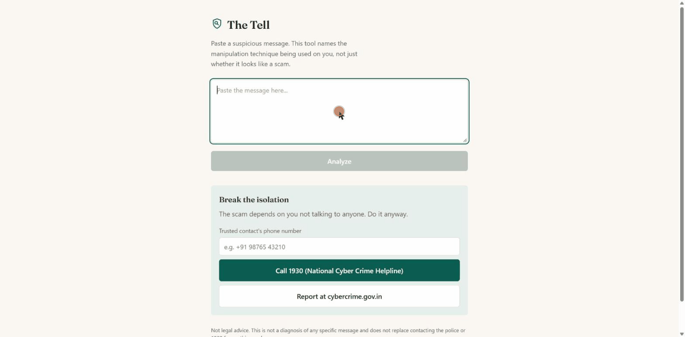

# The Tell

A scam shield that names the manipulation technique a message uses and explains how it works.

Spam detection is solved and crowded. The unsolved problem is that detection doesn't
change behavior. Victims of digital-arrest and UPI scams are frequently told
"this is a scam" and proceed anyway, because a live human is applying pressure and
the app is a red icon. This project bets on counter-persuasion instead: naming the
specific technique being used, grounded in verifiable facts, in language a person
under pressure will believe.

A 150M-parameter distilled classifier gates a much larger teacher model. Roughly
71% of messages are resolved by the small model alone and never reach the
expensive one. The teacher is a local Ollama model, configured in `app/config.py`.



Complete: taxonomy, both layers, gold labeling, distillation, three-way eval,
inter-annotator kappa, the student cascade, the human study (N=20), and
end-to-end UI verification. `docs/DESIGN_RULES.md` lists the design rules this
codebase holds to.

> **Recently corrected (2026-09-09).** Two results in this README were wrong
> and have been fixed in place:
> 1. Eval B's H2 is withdrawn as uninterpretable. The instrument was broken, so
>    the data can't count as a null result either, and it previously read as
>    evidence of no harm. See `study/PREREGISTRATION.md`'s 2026-09-08 amendment
>    and the Eval B section.
> 2. The teacher's macro-F1 is 0.56, up from the 0.51 this README reported.
>    Two independent re-runs confirmed it, and baseline (0.41) and student (0.48)
>    reproduced exactly. All latency figures have been removed from the results
>    table: the same measurement spans a 9.5x range across runs on this
>    hardware, which makes any single number unpublishable. See the latency
>    section below.
>
> A public deployment is in progress. `deploy/` has the setup and the Docker
> path is documented under Setup, but neither has been run end to end yet.

## What to look at

This README is long because it records what went wrong as well as what works.
If you're skimming, these five are the substance:

- The Layer 2 validator was silently passing 0% of explanations. Every
  explanation the human study showed its treatment arm was fallback
  boilerplate instead of model output. The fix was architectural, with no
  prompt change: the model no longer quotes the span, and code inserts it,
  so the guarantee holds by construction. See "Layer 2 validator pass rate"
  below, and `app/explain.py`.
- Held-out thresholds reversed the headline result. Per-technique thresholds
  were originally tuned and scored on the same 250 messages. Moving to 5-fold
  held-out calibration put the student behind the teacher instead of ahead of
  it, and the worse number is the one reported. `eval/metrics.py`.
- The eval leaked, and this project found the leak. The student had trained on
  190 of the 250 gold messages, so 76% of its "generalization" score was
  memorization. It was retrained clean. `eval/distill.py`.
- A pre-registered hypothesis was withdrawn because its measurement could not
  have detected what it claimed to rule out. Withdrawal is a separate outcome
  from a null result. See Eval B below, and `study/PREREGISTRATION.md`.
- The shipped cascade is measured, and its headline failure turns out not to
  be one. The student gate silences 9 of 69 scam messages, which sounds bad
  until you check them against the second annotator. On all six that were
  double-labeled, the second annotator disagreed with the primary, and on five
  they said there was no technique at all. The gate is siding with annotator 2.
  `eval/cascade_eval.py` and `ERROR_ANALYSIS.md`.

The classifier itself is mid, and says so: held-out macro-F1 falls between 0.41
and 0.56 across baseline, student and teacher. What this repo demonstrates is
the measurement discipline around it.

## Architecture

```
paste text ──> GATE: distilled ModernBERT student (app/student.py)
               high-recall pre-filter, runs locally, no verbatim spans
                              │
               nothing clears the gate? ──> "no techniques detected", teacher never called
                              │ (something fired: ~29% of messages)
                              ▼
               Layer 1: multi-label technique classifier
               schema-constrained decoding; teacher is local
               Ollama/Qwen2.5-7B
                              │
               techniques[] + verbatim spans + confidence
                              ▼
               Layer 2: grounded explanation generator
               (retrieves facts from counter_moves.yaml, never invents them)
                              ▼
               Layer 3: break the isolation
               (one-tap trusted contact, 1930 helpline, share-to-verify)
```

The student runs in the live system as well as in the benchmarks. `/analyze`
runs it first as a deliberately high-recall gate, and only wakes the teacher
(accurate, but ~5s/message) when the student finds something worth
investigating. Roughly 71% of real messages resolve on the fast student-only
path, measured against the gold set (see `eval/gate_calibration.py` and
`ERROR_ANALYSIS.md`). The student has no notion of verbatim spans, so it can
never be the thing that answers on its own; Layer 2's span-grounding guarantee
always comes from the teacher. If the student model isn't present (a fresh
clone before `eval/distill.py` has run), the gate is skipped and every message
goes straight to the teacher, as it did before the cascade existed.

## Setup

### With Docker (fewer steps)

```bash
docker compose up --build
docker compose exec ollama ollama pull qwen2.5:7b-instruct-q4_K_M
# UI on http://localhost:3000, API on http://localhost:8000
```

The model pull is a separate step because it's 4.5GB and only needs doing once;
baking it into the image would re-download it on every rebuild. It's kept in a
named volume so `docker compose down` doesn't cost you a re-pull.

Two caveats. The cascade gate needs the distilled student, which isn't in the
image (`backend/models/` is gitignored, ~574MB). Set `STUDENT_HF_REPO` to
enable it, or run without it and every message goes to the teacher. The teacher
also runs on CPU here. The GPU passthrough stanza in `docker-compose.yml` is
commented out because on Windows it needs WSL2 plus the nvidia-container-toolkit,
which is the setup friction this path exists to avoid.

**These compose files have not been run.** They were written on a machine
without Docker installed. The YAML validates and the Dockerfiles are
conventional, but treat the first `up --build` as unproven.

### Manually

```bash
# Backend: use a venv. This project's teacher/distillation deps
# (transformers, torch) commonly clash with whatever else is in a shared
# global Python install. Seen firsthand: a global triton/unsloth-zoo from
# an unrelated project broke transformers' import here. An isolated venv
# avoids that entirely.
cd backend
python -m venv .venv
source .venv/Scripts/activate   # Windows Git Bash; use .venv\Scripts\activate.bat for cmd.exe

# CUDA torch first. Plain `pip install torch` or requirements.txt gives you
# a CPU-only build, which is useless on this machine's RTX 4060 (see the
# note in requirements.txt).
pip install torch --index-url https://download.pytorch.org/whl/cu124
python -c "import torch; print(torch.cuda.is_available())"   # must print True

pip install -r requirements.txt

# Ollama (local LLM runtime): install from https://ollama.com, then:
ollama pull qwen2.5:7b-instruct-q4_K_M

# Corpus: raw files are gitignored (large, re-downloadable), so build them:
curl -sL -o backend/data/corpus/raw/sms_spam_uci.zip \
  "https://archive.ics.uci.edu/static/public/228/sms+spam+collection.zip"
unzip -o backend/data/corpus/raw/sms_spam_uci.zip -d backend/data/corpus/raw/
python backend/data/build_corpus.py

# Frontend
cd frontend
npm install
```

The Mendeley SMS Phishing dataset (`f45bkkt8pr`) has no stable direct-download
URL. Download it manually from
[data.mendeley.com](https://data.mendeley.com/datasets/f45bkkt8pr/1) and drop
the CSV into `backend/data/corpus/raw/` if you want the extra volume. The
pipeline works without it.

## Running

```bash
ollama serve &
cd backend && uvicorn app.main:app --reload
cd frontend && npm run dev
```

## Testing

```bash
cd backend && pytest        # 100 tests: taxonomy/counter-move integrity and
                             # source-citation checks, classify/explain logic,
                             # metrics, the cascade gate, the teacher client,
                             # full /analyze (mocked at the LLM boundary)
cd study   && pytest        # 24 tests: study analysis + spreadsheet round-trip

python eval/run_eval.py     # baseline classifier metrics against the corpus
```

## Evals

The evals have two spines. One is classifier performance: baseline vs. teacher
vs. distilled student, cost-weighted for false negatives. The other is a small
pre-registered human study testing whether named-technique explanations change
stated behavior compared to a plain scam flag. Eval A results are below, and
the results of Eval B (the human study, complete) follow them.
`study/PREREGISTRATION.md` has the hypothesis and analysis plan, committed
before any participant ran.

```bash
# Silver-label ~1000 corpus messages with the local teacher (for distillation)
python backend/eval/silver_label.py

# Real distillation once silver labels exist (falls back to a smoke test otherwise)
python backend/eval/distill.py

# Three-way baseline/teacher/student comparison against the gold set
python backend/eval/compare.py

# Measure the cascade gate's scam-recall / teacher-wake-rate trade-off
python backend/eval/gate_calibration.py

# Score the system that actually ships: student gate -> teacher, composed, so
# the number describes the product rather than one of its components
python backend/eval/cascade_eval.py

# Get a second annotator (not a study participant) to label the
# 80-message kappa subset, either via CLI:
python backend/eval/label.py --annotator second --kappa-subset 80
# ...or hand them a small spreadsheet instead of asking them to run Python:
python backend/eval/export_labeling_sheet.py --annotator second --kappa-subset 80
#   -> send them gold_labeling_second.xlsx, they fill it in, you get it back
python backend/eval/import_labeling_sheet.py --annotator second

# Cohen's kappa between labels_primary.jsonl and labels_second.jsonl
python backend/eval/kappa.py

# One-time: freeze Layer 1/2 output for the study's 6 fixed stimuli
python study/build_stimuli_cache.py

# One run per participant (randomly, balanced, assigned to control/treatment)
python study/run_study.py

# Fixed analysis plan against collected responses
python study/analyze_study.py
```

The numbers below run against the 250-message hand-labeled gold set
(`backend/data/corpus/gold/labels_primary.jsonl`), with single-annotator labels
for the classifier metrics themselves. A second annotator separately labeled an
80-message subset for inter-annotator agreement: macro-average Cohen's kappa =
0.68 (above the pre-registered 0.6 threshold), message-level binary ("any
technique present") kappa 0.66, exact label-set match rate 0.70. One technique
is too far off to be noise: `reciprocity_hook` kappa = -0.02, because the
annotators disagreed about the technique's scope. The full breakdown is in
`backend/eval/ERROR_ANALYSIS.md`'s 2026-08-23 update (`eval/kappa.py`).

Per-technique thresholds are chosen via 5-fold cross-validation. Each fold's
threshold is picked using only the other folds, so every message is scored by
a threshold that never saw its own label (`eval/metrics.py`'s
`per_technique_metrics_cv`). `eval/compare.py` also prints the simpler
in-sample numbers for comparison. They run noticeably higher, and that gap is
the finding (see `ERROR_ANALYSIS.md`, which also has the full caveats and
per-technique failure analysis).

### Results (three-way comparison, N=250 gold, held-out threshold CV)

| System | Macro-F1 | Macro-P | Macro-R | Latency/msg | Size |
|---|---|---|---|---|---|
| Baseline (TF-IDF + LR) | 0.41 | 0.33 | 0.55 | ~0ms (CPU) | negligible |
| Teacher (Qwen2.5-7B, live) | 0.56 | 0.79 | 0.48 | see below | ~4.5GB |
| Student (distilled ModernBERT) | 0.48 | 0.42 | 0.60 | see below | 574MB / 150M params |
| Deployed cascade (gate → teacher) | 0.55 | 0.81 | 0.46 | see below | n/a |

Run via `eval/compare.py`, same 250 gold messages for all three systems,
thresholds calibrated held-out. The latency column has no figures; the latency
section below explains why.

#### What the gold set measures

190 of the 250 messages are UCI SMS spam: 2000s-era UK text-message spam, in a
different language and from a different era than the Indian digital-arrest and
UPI scams this project targets. Of the 69 messages carrying at least one
technique, 45 were written by the same person who designed the taxonomy and
assigned the labels. Labels are single-annotator, with macro-average Cohen's
kappa 0.68 against a second annotator on an 80-message subset.

So these scores measure the taxonomy against its author's own distribution
more than against live scam traffic. The obvious suspicion is that the
hand-written training messages are near-duplicates of the hand-written eval
messages. That was checked and does not hold: TF-IDF cosine similarity between
each `IN-*` gold message and its nearest training neighbour is mean 0.13,
median 0.10, with exactly one pair above 0.5. The two sets share an author and
a vocabulary, with no leakage. An independent test set, collected from real
reported scams and labeled by someone else, is the single thing that would
most improve the credibility of every number on this page.

#### Latency

An earlier measurement reported student latency as low as 14ms/msg. That was a
measurement artifact. The student ran immediately after ~20 minutes of
continuous teacher inference on the same GPU and inherited boosted clock speeds
it doesn't normally sustain. Repeated clean measurements of the same
250-message pass, in a fresh process, landed in the 65-175ms/msg range.
`nvidia-smi` confirms why: this laptop's RTX 4060 idles at 1890MHz against a
3105MHz boost ceiling, and single bursty inference calls (one message at a
time, which is how a live product is used) don't hold it at boost. This
project's standard is to never round up a good number, so the correction is
made here in the open.

As of 2026-09-09, latency on this hardware doesn't reproduce well enough to
publish any number. Three independent runs of the same 250-message pass, same
script path, same model:

| Run | Teacher | Student / gate |
|---|---|---|
| 2026-08-18 | 4966 ms/msg | 65-175 ms/msg |
| 2026-09-08 (`cascade_eval.py`, gate first) | 523 ms/msg | 315 ms/msg |
| 2026-09-09 (`compare.py`, clean) | 2794 ms/msg | 216 ms/msg |

The teacher spans a 9.5x range across runs. Whether Ollama already had the
4.5GB model resident, and what clock state the GPU was in, plausibly dominate
the measurement. The bias has a consistent direction. The student's fastest
figure (216ms) comes from the run where it executed immediately after a
20-minute teacher pass, the same condition that produced the discredited 14ms
artifact. Its slowest (315ms) comes from the run where it went first on an
idle GPU.

So the results table has no latency point estimate. A laptop-GPU number that
moves by 9.5x between runs is not a measurement, and publishing the flattering
end of that range would repeat the mistake this section already documents.
What survives is what doesn't depend on wall-clock time: the student is ~30x
smaller (150M vs 7B params, 574MB vs 4.5GB), and the gate removes 71% of
teacher calls entirely.

#### Accuracy reproduces

Baseline (0.41) and student (0.48) held-out macro-F1 came back identical
across runs. The teacher came back at 0.56 in two independent runs, replacing
the 0.51 previously reported here, and the results table now uses 0.56. The
likely cause is the fold-to-fold instability documented in
`ERROR_ANALYSIS.md`: one flip on a 3-support technique moves the macro average
~0.03. That instability is also the argument for reading the per-technique rows
over the macro line.

#### Student versus teacher

The student trades accuracy for size and throughput. An earlier version of this
table, with in-sample thresholds, had the student slightly ahead of the teacher
(0.56 vs 0.52). That ranking didn't survive moving to held-out thresholds. With
held-out calibration the teacher is back in front, 0.56 vs 0.48.

The gap has a legible, support-driven cause. Per-technique, held-out
(2026-09-09 run):

| | student wins | teacher wins |
|---|---|---|
| 4 highest-support techniques (24-36) | 3 | 1 |
| 7 lower-support techniques (3-12) | 1 | 6 |

Where the student had enough positive training examples it is competitive or
better: `fear_of_consequence` 0.88 vs 0.50, `false_authority` 0.77 vs 0.42,
`reciprocity_hook` 0.68 vs 0.55. Where it didn't, it falls apart:
`payment_irreversibility` 0.00, `channel_switch` 0.12. The teacher's single
loss among the low-support techniques is `trust_transfer`, where it scores a
flat 0.00 (see below).

Re-running the eval corrected two claims in an earlier version of this
section. `manufactured_urgency` is a tie within noise (0.59 vs 0.60) instead of
a student win, so the student wins 3 of the top 4 rather than all 4. And this
hardware can't support the "large, real latency win" the section used to
assert (see the latency section). The defensible version of the trade: ~30x
smaller and 71% of teacher calls eliminated, for 0.08 macro-F1.

`ERROR_ANALYSIS.md` has the full per-technique breakdown.

#### Distillation quality gap

The first real distillation run scored macro-F1 = 0.10, with zero recall on 8
of 11 techniques. Root cause: the ~940-message silver-labeled training pool had
almost no positive examples for most techniques, because the corpus behind it
is mostly generic UCI SMS spam, which doesn't contain India-specific
digital-arrest/UPI manipulation language. The fix was more training data, with
no tuning of the training loop: 78 new hand-labeled messages targeting the
underrepresented techniques
(`backend/data/corpus/raw/handcrafted_india_train.jsonl`, training-only, never
touches the gold-eval set). Re-running distillation on the augmented pool took
gold-holdout macro-F1 from 0.10 to 0.47, and every technique moved off zero
recall. The score later became 0.56 in-sample once a train/eval leakage bug was
fixed (see `eval/distill.py`'s `load_training_data` docstring), and 0.48 under
the held-out threshold calibration in the results table.

#### Known failure modes

The teacher is blind to `trust_transfer` (impersonating a specific known
person, e.g. "Mom, I lost my phone"). It scores P=R=F1=0.00 on all 4 gold
positives, including one live-reran case where it actively mislabeled the
textbook "Hi Mum" scam as `reciprocity_hook`. The student does better (held-out
F1=0.33), but the technique stays hard for both models.

False positives on benign transactional or advisory messages (a legitimate bank
OTP, an electricity bill reminder, a bank's own anti-scam PSA) are the finding
to take most seriously for a "never say safe" product. The student's held-out
`payment_irreversibility` row is F1=0.00 (0 true positives caught across all 5
folds) because the model picks up "Rs amount + payment verb" as a surface cue,
which real scams and legitimate messages share, in place of the technique's
definition. `ERROR_ANALYSIS.md` has the full breakdown, with message-level
examples.

#### Bugs found along the way

Three bugs surfaced, all fixed:

1. The Layer 2 validator checked that a technique's span appeared verbatim but
   not that it was quoted, so one live explanation came out as a run-on,
   ungrammatical sentence. This is now checked (see "Layer 2 validator pass
   rate" below).
2. Per-technique thresholds were originally tuned and scored on the same
   250-message set, which gives an in-sample upper bound rather than an
   estimate. The 5-fold held-out calibration described above fixed it.
3. The teacher occasionally emits a confidence value outside [0, 1], in about
   0.2 to 5% of calls. Schema-constrained decoding enforces JSON shape but not
   numeric bounds, so this used to raise an unhandled 500 on `/analyze`.
   `app/llm.py`'s `generate_structured` now clamps a pure range violation to
   its declared bound and logs it. Confirmed live: 2 clamped, 0 errors across
   the 250-message teacher pass behind the results table.

#### Layer 2 validator pass rate

The pass rate was initially 0%. `study/stimuli_cache.json`'s frozen
treatment-arm text was all table-only fallback, with no real LLM output. The
old schema asked the model to both quote the manipulated span verbatim and
explain its purpose in one field, and it almost never did the first part. The
fix narrowed the model's job to the purpose clause and inserts the verbatim
quote programmatically from the Layer 1 span. Re-verified against all 60
`handcrafted_india` messages after the fix: 59/59 cards (100%) passed
validation on the first attempt, with 0 retries and 0 fallbacks.

### Results (Eval B, human study, N=20)

20 participants, block-randomized 10 control / 10 treatment, 120 responses
total (6 fixed stimuli each: 4 scam, 2 legitimate). The fixed analysis plan and
hypotheses are in `study/PREREGISTRATION.md`. Reproduce with
`python study/analyze_study.py`.

| | Control | Treatment | Difference (treatment − control) |
|---|---|---|---|
| H1: resistant on 4 scam stimuli | 39/40 = 0.97 | 39/40 = 0.97 | +0.00 (95% bootstrap CI [-0.07, +0.07]) |
| H2: resistant/distrustful on 2 legitimate stimuli | 17/20 = 0.85 | 16/20 = 0.80 | -0.05 (95% bootstrap CI [-0.30, +0.20]) |

#### H1: a null result

Both arms already resist ~97% of the time on these four scam stimuli, whether
they see a named technique or a plain flag. That ceiling effect leaves little
room for the explanation to move the needle in a forced-choice reading context.
The CI is wide, as the pre-registered N=20 was expected to produce, and is
consistent with anything from a 7-point loss to a 7-point gain from the
named-technique explanation. "No detectable difference on the primary outcome"
is one of the two explicit "what would change our mind" outcomes named in the
pre-registration, and it's reported as exactly that, with no reframing after
the fact.

#### H2: withdrawn as uninterpretable

An earlier version of this README reported "no H2 harm signal" and read the
numbers as reassurance. That was wrong in the worst way: an affirmative safety
claim drawn from a measurement that could not have detected the harm it
claimed to rule out. A post-hoc audit found two defects, both in the design
rather than the data:

1. The two arms saw the same screen on the only two stimuli H2 uses. S5 (bank
   OTP) and S6 (delivery notification) both classified clean, so control got
   `[No warning was flagged for this message.]` and treatment got
   `No manipulation techniques detected.`, which is the same content worded
   differently. There was no explanation to show, because the system correctly
   found nothing. The only remaining mechanism is carryover from the four
   explanations seen earlier, which is a far weaker test than the one
   pre-registered and was never stated as the mechanism.
2. `ignore` was coded as "distrust." On a scam message that coding is sound.
   On a legitimate informational message it is wrong, because ignoring a
   delivery notification is the correct, ordinary response and no false alarm.
   Of the responses counted as "distrustful" on the legitimate stimuli, 15 of
   17 (control) and 16 of 16 (treatment) are literally `ignore`. The 0.85 /
   0.80 figures measure "did you decline to act on an informational SMS." An
   85% distrust rate for a routine HDFC OTP is implausible on its face, which
   is the tell.

`analyze_study.py` still prints the numbers, since deleting them would hide the
error instead of reporting it. They appear under an explicit UNINTERPRETABLE
header that carries both defects and the ignore-share diagnostic, so they
cannot travel without the caveat. The full write-up is in
`study/PREREGISTRATION.md`'s 2026-09-08 amendment, logged through that
document's own amendment mechanism instead of edited into its body.

The corrected instrument is built and deliberately left unrun. H2 needed a
direct judgment, *"Do you think this message is genuine?"*, in place of one
inferred from a chosen action, since on a legitimate message answering "no" is
a false alarm regardless of what the participant would do. It is wired through
the CLI, the spreadsheet export/import, and the analysis. Re-running with 20 new
participants is out of scope, and back-filling the existing 20 is impossible by
design: participant ids are random and unlinked to identity.

#### Per-stimulus counts

These are descriptive only. The pre-registration is explicit that the six
stimuli are not six separate experiments, so this table supports error
analysis and no inference.

| Stimulus | Control resistant | Treatment resistant |
|---|---|---|
| S1 digital arrest | 10/10 | 10/10 |
| S2 UPI collect request | 9/10 | 10/10 |
| S3 family impersonation | 10/10 | 9/10 |
| S4 lottery/prize | 10/10 | 10/10 |
| S5 bank OTP (legitimate) | 9/10 | 8/10 |
| S6 delivery notification (legitimate) | 8/10 | 8/10 |

Most of the non-resistant responses in both arms cluster on S5 and S6, so the
ceiling isn't quite 100% there either. That is the more interesting thread for
anyone extending this study: the messages closest to fooling someone are also
the ones where this N had the least room to show an effect either way.

#### What the study establishes

One null result on the primary outcome (H1), from a ceiling effect at N=20,
and one hypothesis (H2) that turned out to be unmeasurable with the instrument
pre-registered for it. That is a thinner result than the earlier write-up
claimed. The study asked whether naming the technique changes stated behavior,
and it did not answer that question. It could not have answered the
false-alarm half of it at all.

The study stays in the repo deliberately. The pre-registration, the fixed
analysis plan committed before any participant ran, the block randomization,
and the refusal to reframe a null after the fact all held up. The defect was
found afterwards, in this project's own instrument, and reported in the
document that specified it.
